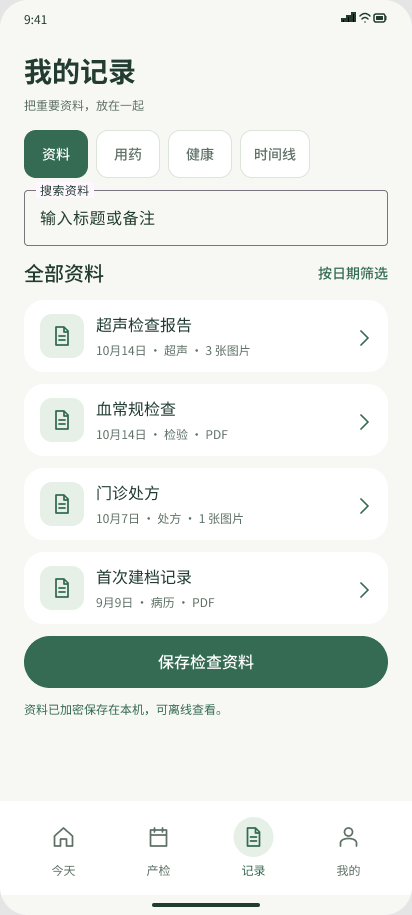
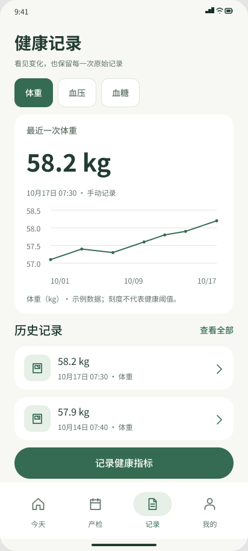

# UI 细节检查与修订

- 日期：2026-10-17 开始，2026-10-18 完成（Asia/Shanghai）。
- 阶段：S01，首轮 UI 后的精修。
- 范围：现有 20 页，沿用暖白/绿色与 Noto Sans SC；不扩展业务页面。
- 状态：本轮修订与复查已完成，待用户评审。

## 当前截图发现

| 编号 | 问题 | 处理目标 |
|---|---|---|
| D01 | 前八页状态栏宽度为 96，其余页为 412，系统图标有时消失 | 全部统一尺寸与矢量系统图标 |
| D02 | 按钮外层 364，内部可见背景随文案收缩至约 96–190，视觉与点击范围不一致 | 主次按钮可见背景与外层同宽、统一高度和圆角 |
| D03 | 标签全部为浅绿色，无法辨别当前选择；最小宽度只有 40，高度 34 | 选中/未选中明确区分，并提供至少 48 高的交互区域 |
| D04 | 记录行使用 +、✓、◷、▤ 等字体符号，形态/粗细/基线不统一，日期容器 44×46 | 使用统一矢量图标与方形容器 |
| D05 | 部分资料键值直接相连，缺少稳定的左右列与留白 | 固定标签列和对齐的值列 |
| D06 | 体重趋势以零基线柱状图暗示数据，末尾日期位于中段，无纵轴 | 提供固定虚构演示数值、正确日期位置、数值刻度与单位 |
| D07 | 日期、孕周、计数、返回提示的空格与标点不一致 | 统一文案格式并保留对象来源含义 |
| D08 | 多处提示行以文字 ✓ 充当图标，部分状态徽章无实际区分意义 | 状态反馈使用一致表达，避免装饰符号造成错位 |

## 证据

本轮新截图覆盖首页、建档、资料列表、资料详情、用药、健康、备份、欢迎页。图像保存在 `audit-20261017/before/`；修订后关键图像保存在 `audit-20261017/after/`。

## 已实施的修订

- **D01**：20 页状态栏统一为 412 × 34，信号/Wi-Fi/电量使用同一组矢量，不再混用文字符号。
- **D02**：29 个按钮统一为 364 × 52、圆角 26，可见背景与外层一致；主操作深绿、次操作浅绿。原嵌套 Material 组件存在内层收缩约束，已将本地按钮母版整理为同规格品牌组件，保留既有母版/实例 ID、文案与原型关系，并增加共享 button 文字样式和 Label 文本属性。
- **D03**：6 组标签的选中态采用深绿底白字，未选中采用白底描边；高度 48、最小宽度 64；状态徽章不与交互标签混淆。
- **D04**：35 条记录行替换字体符号；10 个图标母组件统一 24 × 24、1.75 描边，记录行前导容器 44 × 44、圆角 12，箭头尺寸 20。行高 72、左右内边距 16、内部间距 12，正文区域 244，使箭头右侧留白一致。欢迎说明和导入成功项隐藏无意义箭头。
- **D05**：资料详情标签列 96、间隔 16、值列 212，避免“资料类型超声”等相连。保留原有文字含义。
- **D06**：体重改为固定虚构数据折线，纵轴标明数值、单位 kg 与非健康阈值提示；日期按真实日间距定位，末日对齐最后一点；最近两次值与列表 57.9/58.2 一致。
- **D07**：孕周统一成“18周 + 3天”，数字与计数单位适当留空，恢复步骤格式统一，修复“返回 · 返回我的”重复文案。日期继续采用中文月日，图表轴使用紧凑月/日格式。
- **D08**：去除提示行中装饰性的文字勾选符，使用明确文字表达状态。徽章保留进行中、完整性校验等有意义内容。
- **额外修复**：用药方案卡内部间距调整为 8，保留底部说明完整可见；辅助文字颜色从 `#65766D` 调整为 `#5F7166`，暖白背景对比度由约 4.51:1 提升至约 4.87:1。

## 八个视觉检查步骤

| 步骤 | 画面与结论 | 修改前 | 修改后 |
|---|---|---|---|
| 1 | 首页：系统栏、记录图标、箭头边距已统一 | [前](audit-20261017/before/01-首页.png) | [后](audit-20261017/after/01-首页.png) |
| 2 | 资料列表：选中态明确，按钮背景同宽且长文案完整 | [前](audit-20261017/before/02-资料列表.png) | [后](audit-20261017/after/02-资料列表.png) |
| 3 | 健康趋势：日期与数据位置对应，刻度和单位完整 | [前](audit-20261017/before/03-健康趋势.png) | [后](audit-20261017/after/03-健康趋势.png) |
| 4 | 备份：主次操作一致，返回文案与记录图标已修正 | [前](audit-20261017/before/04-备份.png) | [后](audit-20261017/after/04-备份.png) |
| 5 | 欢迎：不再出现无作用的右箭头，两按钮与内容同宽 | [前](audit-20261017/before/05-欢迎.png) | [后](audit-20261017/after/05-欢迎.png) |
| 6 | 建档：按钮对齐，浮动标签与日期依据完整可见 | [前](audit-20261017/before/06-建档.png) | [后](audit-20261017/after/06-建档.png) |
| 7 | 用药：标签状态清晰，按钮同宽，底部说明没有越界 | [前](audit-20261017/before/07-用药.png) | [后](audit-20261017/after/07-用药.png) |
| 8 | 资料详情：键值分列，关联产检图标正确，操作按钮一致 | [前](audit-20261017/before/08-资料详情.png) | [后](audit-20261017/after/08-资料详情.png) |

## 验证结果

- 对现有全部 20 页进行结构扫描，内容未越过可用区域，扫描的横向容器无子项越界。
- 所有 29 个按钮为 364 × 52，母版背景即按钮可见背景；35 条记录行保留为实例。
- 20 页系统栏尺寸一致，交互标签高度均为 48。
- 原有 63 条显式跨页原型连接逐一核对，缺失 0；三个流程入口保留。继承反应数量由 118 降为 86，是移除嵌套按钮内部继承反应的结果，不代表业务导航丢失。
- 对 8 个代表页面截图复查，共归档修改前/后 16 张；最后一次颜色与母版调整后重新截图，归档副本已查看。
- 计算代表颜色对比度：正文/暖白 11.18:1、辅助文字/暖白 4.87:1、白字/主绿 6.21:1、辅助文字/白色 5.20:1；不据此宣称完整无障碍合规。
- 当前示例日期仍固定为 2026-10-17，不表示应用已实现实时日期或调度。

机器检查证据见 [结构结果](figma-detail-validation.json)、[按钮修订](figma-detail-buttons-result.json) 和 [节点索引](figma-state.json)。后续编辑以实时画布为准，不重放历史构建脚本。

## 后续开发需保持的规则

1. 组件间复用 token 和母版，不为单页临时改变字号、箭头、边距或按钮宽度。
2. 多选、未选、禁用、错误状态不只使用颜色区分；Android 实现时提供语义和屏幕阅读器状态。
3. 标题与动态值分别约定换行/省略，长医院名和药名不得挤掉主操作或数值单位。
4. 键盘弹出、大字体、不同屏宽和动态加载必须在设备上测试；画板不替代真实布局验证。
5. 图表不补零、不混单位、不伪造健康阈值，示例点与列表须来自同一数据源。

## 验证边界

这是可编辑 Figma 稿的视觉与结构检查，不代表真实 Android 点击、TalkBack、键盘、系统权限或动态字体测试通过。仅可见且有充分证据的细节直接修正；未展开业务页仍列在阶段记录中。
