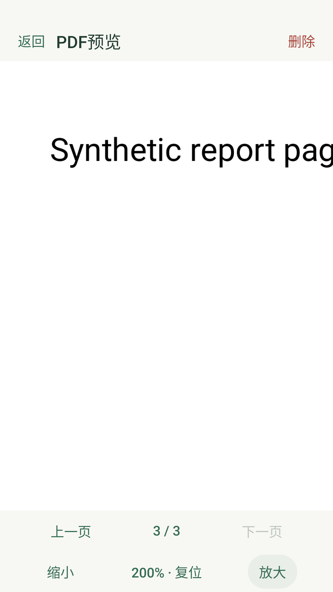

# 0.5.0-dev / B05 PDF预览与资料检索验证

日期：2026-10-18。版本：versionCode6，schema4。

## 最终结果

- debug构建成功；[13项单元测试](unit-results.json)全部通过。
- 专用API34模拟器30项设备测试全部通过，0失败/0忽略。[完整验证输出](verification.log)。LargeTest性能采样不计入本轮功能用例。
- 小米手机API36上4项隔离测试全部通过：PDF多页渲染/400万像素上限/关闭清理、损坏PDF保留原件、分类重命名及回收站恢复、schema1/2/3升级4保留既有档案/草稿/资料。[真机测试输出](phone-tests.log)。没有启动受小米安全中心拦截的ComponentActivity测试宿主。
- lint：0错误/17警告，14条版本升级提示、2条平台Exif建议、1条已有Canvas KTX建议。[输出](lint-results.txt)。依赖未升级。
- 手机已覆盖安装0.5.0-dev，版本与启动检查见[仅含确认标记的记录](phone-install.json)。未清空应用数据，未操作手机真实报告；测试数据库、源文件和预览目录均为隔离临时数据。
- [APK SHA-256](apk-sha256.json)对应本轮debug交付。输出路径为项目的app/build/outputs/apk/debug/app-debug.apk。

## 检查内容

- 3页合成PDF可前后翻页、跳页，首末页按钮禁用；放大、复位和滚动可用。仅渲染当前页，无多页位图缓存；每张位图最多400万像素，最大边8192。渲染和原件解密在后台线程。
- PDF切后台释放渲染器/文件描述符并清除私有预览文件，回到前台保留页码和放大状态；从预览删除资料仍清理文件。
- 文件损坏不删除加密原件，不阻止后续资料操作；密码PDF未提供密码输入，显示无法预览提示。
- 名称编辑同时更新资料与导入记录，分类持久化；修改不改变原件哈希，回收站恢复保留名称和分类；删除后的资料拒绝元数据修改。
- 搜索仅覆盖本次产检的名称，兼容英文大小写、全角/半角；分类可与搜索组合，匹配为空时可一键清除。排序为最近导入、最早导入、名称顺序，ID保证同值稳定。
- 既有图片双击/双指缩放、拖动、后台清理、删除/撤销/恢复/彻底删除，以及预约/档案导航和草稿回归通过。

## 界面证据

以下仅为模拟器上的合成报告，已打开核对预览标题、当前3/3页、末页按钮禁用和200%复位入口。放大后内容可滚动，截图中的右侧裁切属于放大视口。

## 边界与下一步

- 未完成大PDF、低内存、极低剩余空间及真实提供方极限矩阵，不以400万像素上限替代完整压力验收。
- 本轮没有重新采样导入速度；0.4.0历史性能数据不当作本轮新测结果。
- PDF无全文检索、密码输入、编辑、分享或原件导出；资料分类为固定集合，搜索只限当前产检名称。B05封面指定、重新关联产检、损坏原件替换/导出及D07导出能力继续保留，未宣布完整资料模块验收。
- 下一项为B06全局回收站与孕期/产检级联批次；M0其余门槛、B04来源/极限矩阵及预约动画慢帧仍保留。

API依据：[PdfRenderer](https://developer.android.com/reference/android/graphics/pdf/PdfRenderer)、[Page.render](https://developer.android.com/reference/android/graphics/pdf/PdfRenderer.Page#render(android.graphics.Bitmap,%20android.graphics.Rect,%20android.graphics.Matrix,%20int))，本轮通过Context7核对平台渲染接口，使用API21起可用方法，未新增依赖。
