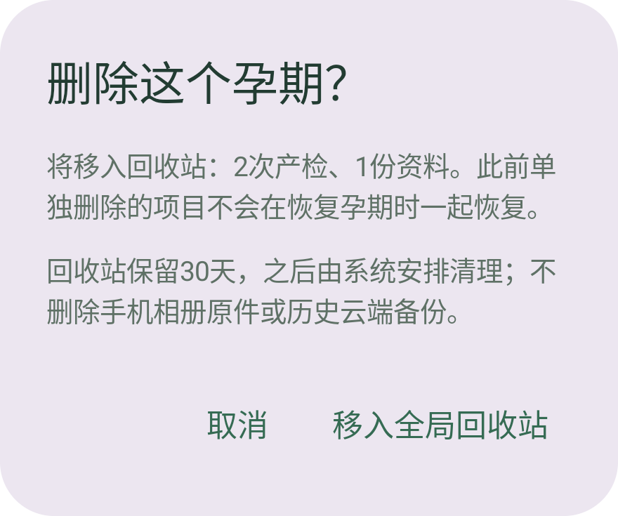
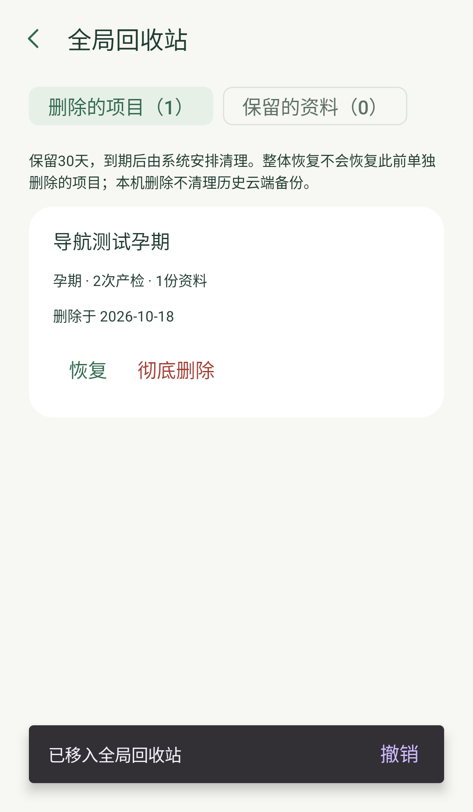

# 0.6.0-dev / B06 全局回收站与级联删除验证

日期：2026-10-18。versionCode7，schema5。

## 结果与证据

- 核心应用代码完整回归：[36项API34模拟器设备测试全部通过](verification.log)，0失败；性能LargeTest不计入功能数量。[13项单元测试](unit-results.json)全部通过。
- [补强交互复测](strengthened-ui.log)：删除最后一个孕期后，回到空首页、进入“我的”→全局回收站，恢复孕期和资料。该用例已包含在36项中，复测不重复计数。
- [6项API36手机隔离测试](phone-tests.log)全部通过，覆盖独立删除与整体恢复、产检永久删除保留报告、文件清理失败后重试、删除与导入并发、30天边界、schema1/2/3/4→5迁移及原有分类/修订号保留。未操作手机真实医疗资料。
- [lint](lint-results.txt)：0错误/17警告（14条依赖升级提示、2条平台Exif建议、1条既有Canvas KTX建议），依赖不变。
- 最终构建和界面文案复核另存[最终构建输出](wording-build.log)与[最终交互复测](wording-ui.log)。完整36项之后只将界面“批次资料”简化为“资料”，不改变删除规则；重新构建、lint及交互复测后再覆盖安装最终包。
- [手机安装确认](phone-install.json)仅保存版本/启动确认标记，不含设备地址、标识或个人资料。[最终APK SHA-256](apk-sha256.json)。开发包：app/build/outputs/apk/debug/app-debug.apk。

## 已验证规则

1. 孕期整体删除持久记录删除批次；恢复仅作用于该批次，此前独立删除的产检和资料保持删除。
2. 产检删除保留报告，从全局回收站的“保留的资料”查看；恢复产检后重新出现在原产检。彻底删除产检内容仍保留报告，之后可独立删除/恢复报告。
3. 孕期彻底删除包括所有所属资料，含此前已独立删除的项目；文件清理成功后才清除日期依据、记录内容和相关草稿。保留无业务内容的来源墓碑与操作状态，防止迟到导入或延迟草稿写回。
4. 模拟文件清理失败时保留PURGING和原件元数据，不假报完成；移除障碍后新建协调器读取持久状态继续成功。清理期间拒绝恢复。
5. 删除发生在导入写盘与提交之间，即便立即恢复父级，持久取消状态仍阻止迟到任务重新挂回资料。
6. 用固定时钟验证30天前不清理、到达边界才清理；启动恢复与每日WorkManager任务负责检查。周期任务受系统调度影响，不保证精确到期时刻。
7. 删除确认展示产检、资料及未完成导入的范围；已有图片/PDF预览、缩放、预约、草稿和导航回归通过。撤销提示在一级页移到导航栏上方，避免遮挡“我的”。

## 合成界面证据

已打开核对，以下均为临时测试库，非个人医疗数据。

## 限制与后续

- 本阶段级联覆盖当前已实现的孕期、产检与资料；M3新增用药/健康后必须扩展同一批次规则。D02正式快照必须包含删除批次、归属字段、清理状态与必要墓碑；P0 ProbeSnapshot不是正式备份。
- 清理中断使用合成文件故障与新协调器恢复验证，未冒称完成所有OEM强杀/断电/极低空间矩阵；30天使用固定时钟测试，未等待30个自然日。
- 真机执行的是6项数据/文件测试，界面自动化运行在专用模拟器；未绕过小米安全中心的Activity测试宿主限制。
- 本机删除不清理手机相册原件，也不删除历史云端快照；云端引用回收仍属D06。
- B05封面指定、重新关联产检、损坏原件替换/导出及大文件低内存矩阵、B04真实来源矩阵、M0其余门槛和预约慢帧继续保留。不是整个M2或V1.0最终验收。
- 下一阶段入口：M3/C01药品与方案版本管理，再推进C02服药记录；新增业务记录同时接入删除批次。

调度API依据：[WorkManager唯一任务](https://developer.android.com/topic/libraries/architecture/workmanager/how-to/managing-work)、[周期任务与调度边界](https://developer.android.com/topic/libraries/architecture/workmanager/how-to/define-work)。
