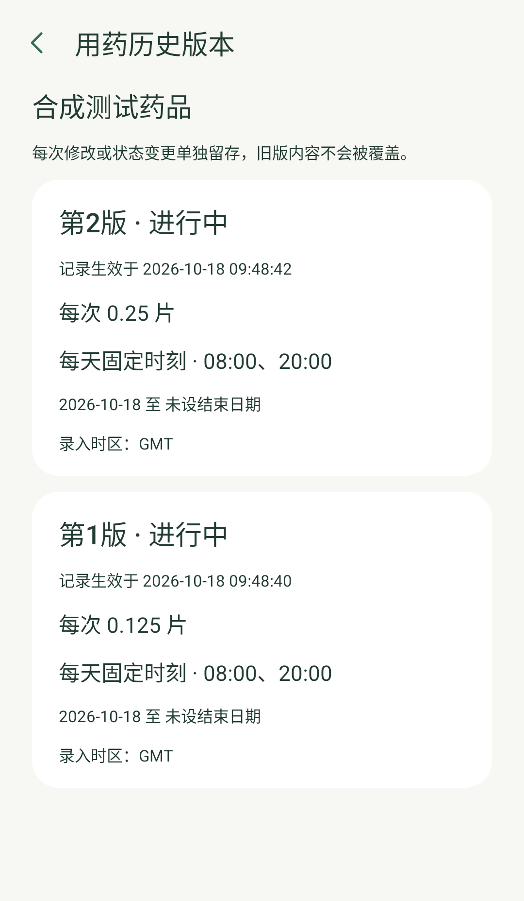

# 0.7.0-dev / C01 药品与方案版本管理验证

日期：2026-10-18。versionCode8，schema6。

## 最终验证

- [16项单元测试](unit-results.json)全部通过，新增精确十进制/剂量单位配对、频次/日期/时刻校验、按需与原文不保留固定时刻规则。
- [40项API34模拟器设备回归](verification.log)全部通过，0失败/0忽略，性能LargeTest不计入功能数量。包括新增3项用药数据测试和1项用药交互，以及已有资料、产检、回收站、导航和草稿用例。
- [4项API36真机隔离测试](phone-tests.log)全部通过：方案历史与状态版本、并发旧版本冲突/跨孕期隔离、用药批次删除恢复及清理、schema1/2/3/4/5→6旧记录/分类/修订号/回收站批次保留。
- [lint](lint-results.txt)：0错误/17警告，14条依赖升级提示、2条平台Exif建议、1条既有Canvas KTX建议。依赖未升级。
- 0.7.0-dev已覆盖安装到手机并启动；[版本与启动确认](phone-install.json)只记录布尔标记，不含设备标识、地址或个人资料。[最终APK SHA-256](apk-sha256.json)。输出包为app/build/outputs/apk/debug/app-debug.apk。

## 业务与交互证据

1. 药品按孕期隔离，名称/规格/剂型首次录入后保留，已有药品可创建其他独立方案；不提供药品或剂量建议。
2. 每次修改或暂停/恢复/结束生成新版本，逻辑方案+版本号唯一；旧版本内容不覆写，生效时刻单调递增。旧编辑与跨孕期引用均拒绝，结束方案不能恢复或继续编辑。
3. 剂量为规范十进制字符串，0.125不会经过浮点计算；剂量与单位同时填写或同时留空。频次为每日固定时刻、每周指定日期、一次、按需、原文；每周至少一天、时刻唯一、起止日期有效，按需/原文不保存固定调度规则。
4. 草稿在加密库中，未改动不新增草稿；返回后恢复名称，保存后清除草稿。新增用药交互覆盖录入→返回恢复→保存→修改剂量→查看旧剂量→暂停新版本。
5. 孕期删除标记药品和全部方案版本，恢复同一批次后内容与状态保持；永久清理按先方案后药品处理，并清除相关草稿，拒绝延迟写回。回收站影响范围与数量包含用药方案。
6. 历史页包含药品名称/规格、每版剂量、时刻/星期、日期、状态、来源/原文及录入时区；时间采用普通年月日时分秒显示。

截图仅含合成药品和临时测试库，已打开核对药品名称、新旧剂量、日期与时区。

## 真机并发等待及修复

首次真机4项最终通过但耗时158.306秒，[原始输出](phone-before-serialization.log)保留；日志显示等待集中在并发修改用例，不当作性能正常。没有将其直接认定为永久死锁或某个驱动缺陷。

在同一个JournalDatabase实例上增加事务入口互斥，前台编辑、草稿、导入与后台清理的显式事务共用，保持Room事务、唯一约束与旧版本校验；文件加解密仍在事务外。并发用例增加30秒测试上限。[修复后单项真机用例](phone-concurrent.log)1.757秒通过，最终完整4项13.557秒通过；这是隔离测试运行时间，不是用户保存延迟或药品业务性能基准。最终40项模拟器回归覆盖这一共同入口变更。

打开新页面前清除旧页面瞬时提示，避免快速连续编辑时旧保存提示覆盖新编辑器按钮。初轮40项39通过/1失败，修正后单项及最终完整回归均通过，中间失败不计验收。

## 范围与下一步

- 本轮仅C01核心方案记录。C02实际服药点、确认/跳过/补记及历史、C05提醒通知未实现；页面明确提示未启用，不能把方案ACTIVE理解成已有通知。
- 药品信息修改、包装照片、药品独立删除/回收站入口尚未提供；不自动解释复杂医嘱，不支持固定间隔调度。新方案不自动结束其他方案。
- 尚未覆盖全部低内存、时区变更、系统强杀/断电及真实来源矩阵。M0门槛、B04/B05剩余范围和预约动画慢帧继续保留，不宣称M3/V1.0验收。
- 下一阶段C02必须按方案版本生效区间生成服药点；旧服药记录引用原版本、发生日期/时区可追溯、重复动作幂等。新增服药记录需继续扩展B06清理顺序。
- D02正式备份须包含药品、全部方案版本及删除归属；P0 ProbeSnapshot不是正式备份。

核对平台资料：[Room3数据库及连接池配置](https://developer.android.com/reference/androidx/room3/RoomDatabase.Builder)。本轮仅依据可复核的等待现象与测试结果决定串行事务入口，不将资料推断写成已确认根因。
