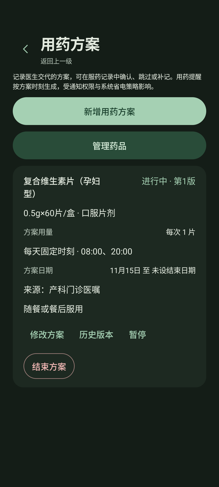
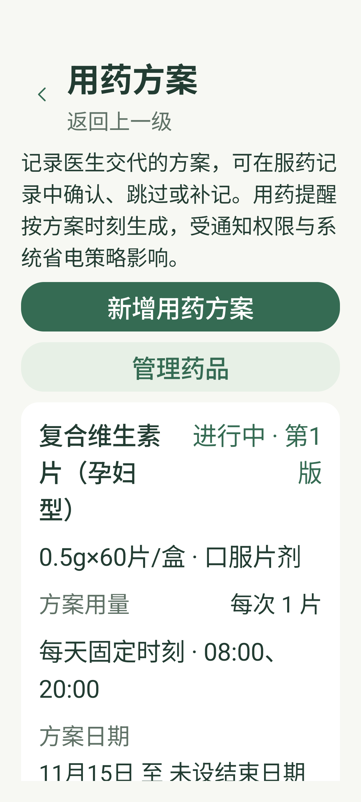
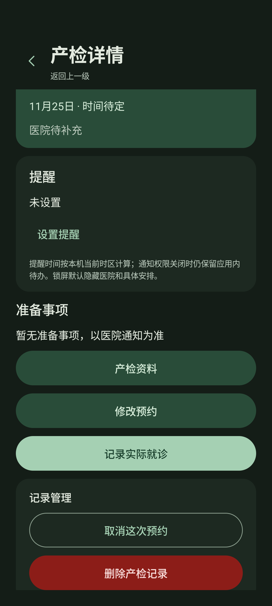
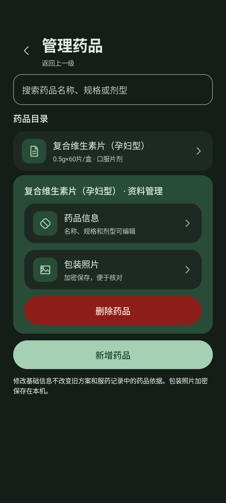
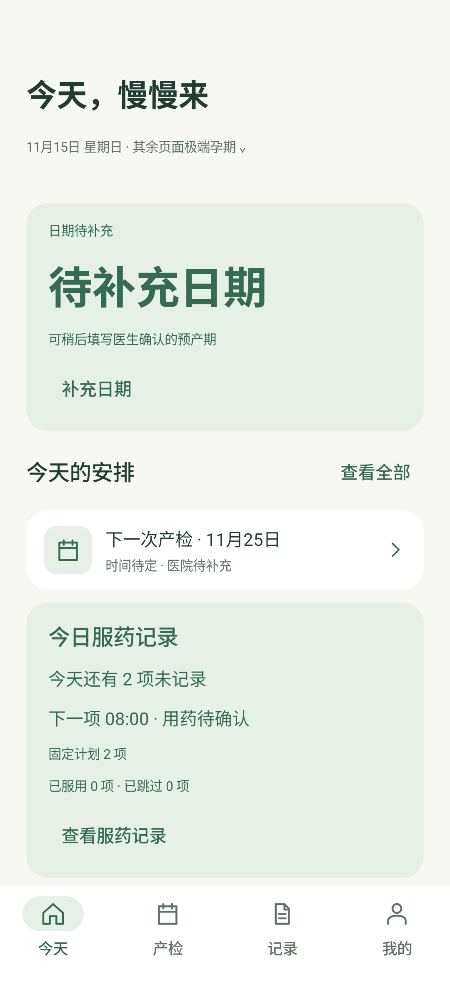
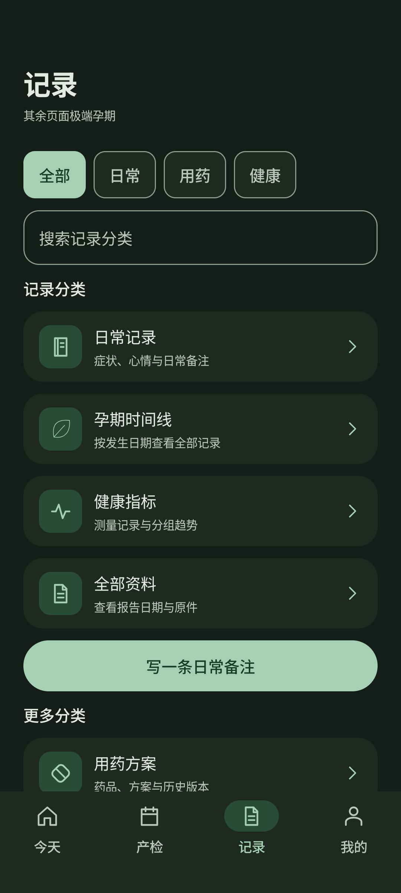
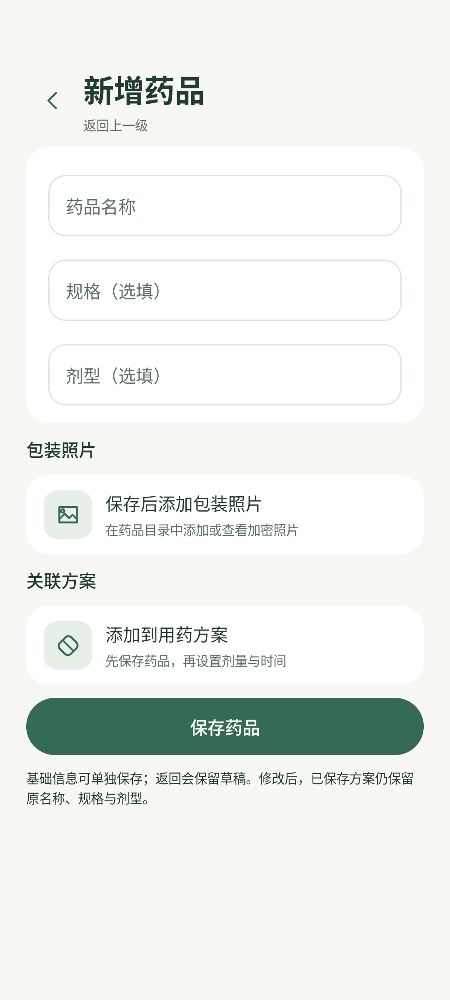

# 组件布局、重点与风格复查

日期：2026-11-15。任务：M6-VISUAL-REVIEW。

结论：当前代表页面的绿色配色、圆角和导航结构整体一致，仍有7项值得优化的视觉问题，其中长标题分配、深色删除按钮权重、图标语义应优先处理。本轮是检查交付，尚未实施以下界面建议；没有恢复用户已去掉的按钮说明或分隔线。

## 检查步骤与整体状况

| 步骤 | 页面 | 状况 | 当前证据 |
|---|---|---|---|
| 1 | 首页 | 信息分区清楚；缺少日期时空状态过重 | [深色](dark/01-today.png)、[浅色](light/01-today.png) |
| 2 | 产检列表及详情 | 列表左右分布正常；详情深色删除按钮抢眼 | [列表](dark/02-visits.png)、[深色详情操作](dark/visit-detail-actions.png)、[浅色详情操作](light/visit-detail-actions.png) |
| 3 | 记录分类与我的 | 分组、行距与导航卡基本统一；部分图标语义遗漏 | [记录](dark/03-records-hub.png)、[我的深色](dark/04-profiles.png)、[我的浅色](light/04-profiles.png) |
| 4 | 用药方案、药品目录/编辑、提醒 | 长标题分配及卡片嵌套偏重；大字内容可达，但换行不够自然 | [方案](dark/05-medications.png)、[药品](dark/drug-catalog.png)、[药品编辑](light/drug-editor.png)、[提醒](dark/reminder-card.png)、[200%方案](large/medications.png)、[200%提醒](large/reminder.png) |
| 5 | 安全、云盘、导出 | 状态分组基本清晰；次要按钮规则与浅色描边值得统一 | [安全](dark/security-settings.png)、[云盘](light/cloud-connection.png)、[清理](light/cloud-cleanup.png)、[导出](light/export-screen.png) |

## 按优先级排列的发现

### V01 优先：内容标题和摘要固定各占一半，空白与折行同时出现

步骤4中，普通字号的“复合维生素片（孕妇型）”已被挤为两行，状态右侧留白仍较多；200%字体下标题分为三行，“第1版”的“版”还单独落行。提醒名称也出现孤立的末字。可读不等于布局合理。

原因：`core/designsystem/Components2.kt` 的 `JournalContentHeading` 给两个Text同样的 `weight(1f)`。建议短状态按内容占宽并设上限，将剩余空间留给名称；两边都放不下时，将状态移到下一行。保持标题与原值完整，不用裁剪掩盖问题。

### V02 优先：深色删除按钮的面积和饱和度过强

步骤2、4中，删除产检记录与删除药品使用整行实色红按钮，在深绿背景中比编辑/查看等日常操作更抢眼。浅色模式相同按钮却是淡粉底，两个主题的视觉权重差异较大。上一轮改善了可点击性，但大面积实色也引入了新的重点竞争。

原因：`Components.kt` 的 `JournalDangerButton` 使用errorContainer；深色值为 `#8C1D18`，浅色为 `#FCECE7`。建议保留完整点击区域与警示文字，常态改为描边或更克制的底色，实色强调留给最终确认；不增加按钮下说明或分隔线。

### V03 中优先：药品管理区出现多层大卡片，边界偏重

步骤4的药品目录先显示药品行，再出现绿色管理大卡，内部又放两张导航卡与删除按钮。同一药名重复，绿色容器和内部卡片都在争夺注意，内容缩进也比其他列表多一层。

原因：`DrugScreens.kt` 中选中药品的 `JournalCard(soft=true)` 嵌入两次RecordRow。建议保留当前选中态与邻近操作，减少其中一层容器，把“药品信息/包装照片”变为同层紧凑入口；删除放末尾，不扩大其权重。

### V04 中优先：首页缺少日期时，空状态占据主视觉

步骤1在“待补充日期”状态仍使用40sp大字和整块强调底色，视觉上压过后续实际预约。深色样本服药摘要还处于无计划显示，两个大块空/待补充状态进一步降低有效内容密度；这不证明资料丢失，截图间的摘要加载状态不同，不能据此判断业务错误。

建议正常孕周摘要继续突出，仅把缺日期状态压缩为标题、状态与补充入口，优先露出当天安排。对应 `JournalApp.kt` 的HomeScreen日期摘要及HomeIntakeSummary。

### V05 优先：仍有同类功能图标语义不一致

步骤3“孕期时间线”仍使用叶片插画；步骤4药品行使用文件图标，下方“药品信息”又使用胶囊。用户需读文字才能区分，且与现有语义图标规范不一致。

原因：`TimelineScreens.kt` 的RecordsHub仍映射 `5fbe7.svg`，`DrugScreens.kt` 药品行仍映射 `cdc29.svg`。建议时间线使用时间/历史类现有图标，药品行统一胶囊；插画保留在欢迎等装饰场景。首页健康快捷入口的旧图标引用也应在实施时一并核对，不将当前被滚动视口遮住的部分作为已确认图像证据。

### V06 中优先：次要操作有两套外观，缺少明确使用边界

步骤2“产检资料/修改预约”和步骤4“管理药品”为整行浅绿填充，取消预约为整行描边，同属次要层级却没有清晰的组件命名规则。并非所有不同外形都应统一；筛选标签、主操作、危险操作本来就应有差别。

原因：`JournalButton(secondary=true)` 与 `JournalSecondaryButton` 分别生成tonal和outlined两种形式，调用时没有说明用途边界。建议明确“主要提交、次要操作、行内动作、危险操作”角色，并为tonal/outlined制定场景规则；避免再逐页增加例外。

证据：[预约操作区](light/visit-detail-actions.png)、[方案页](dark/05-medications.png)、[安全设置](dark/security-settings.png)。

### V07 较低优先：浅色输入框和描边按钮轮廓偏淡

步骤5的导出日期框、步骤4药品编辑的未填写字段，在浅色背景或白卡上边界较弱；取消预约的描边也比深色模式更难辨认。不是边框缺失，而是同一个outline颜色同时承担细分隔和交互轮廓，强度不够区分。

建议交互边框与装饰分隔使用不同强度，轻微加强未聚焦输入框/描边按钮，保留当前轻量风格，不给全部卡片加边框。

## 可以保留的部分

- “我的”的分组标题、行距、图标容器及右箭头已经较统一。
- 产检短记录的项目/时间状态左右布局平衡，不需要为了统一再塞回通用图标。
- 日期与长数值使用的JournalKeyValue会在空间不足时切换上下布局；这是合理适配，不应强制所有页面保持一行。
- 主按钮、过滤标签和导航卡属于不同角色，不应机械统一圆角和外形。
- 用户确认的简洁预约操作区继续保持，无需恢复说明文字或分隔线。

## 证据与限制

本轮刷新当前默认安全APK，在专用模拟器中捕获12类代表页面，包含普通深浅色及200%字体样本。全部被引用图片已保存并打开检查。证据使用合成资料，不包含手机个人资料。长页面截图位于特定滚动位置，屏幕上下边缘的内容续接不能判为布局裁剪。

手机仍连接，但安全窗口无法直接截图；本轮没有修改手机资料或安装新的界面改版，不将模拟器观察称为小米像素验收。未做全应用所有状态、横屏、性能、读屏或无障碍调试。当前发现是视觉诊断，不宣称问题已修复或功能验收全部通过。

执行记录：

- [深色截图步骤9/9](visual-review-dark.txt)，34.072s。首次请求的导出方法名不匹配，没有执行导出；随后使用正确方法在浅色批次补采，不把它算作深色覆盖。
- [浅色首轮5/6](visual-review-light.txt)，29.923s。云盘首页与备份截图已生成，但清理定位仍引用旧文案而失败；不是产品操作失败。
- 仅更新已有截图测试的定位，从旧说明文本改用“立即清理”操作标题；[测试包构建](visual-review-capture-build.log)成功，[云盘定向1/1](visual-review-cloud-retry.txt)，6.409s，补齐清理截图。未改生产界面代码。
- [200%字号2/2](visual-review-large.txt)，14.493s。步骤通过证明可定位和操作，不代表上述换行与重点问题不存在。
- 结束后恢复模拟器深色与100%字体。未重跑全量JVM/仪器测试。

下一步建议按V01、V02、V05先实施，再处理容器层级、首页空态及按钮角色；每项实施后对同一数据和位置复拍深浅色，避免仅凭测试通过判断视觉已改善。
